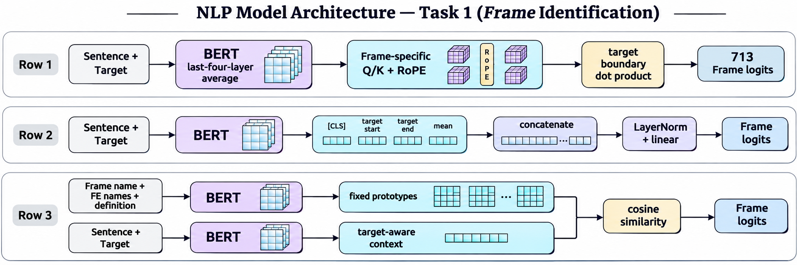
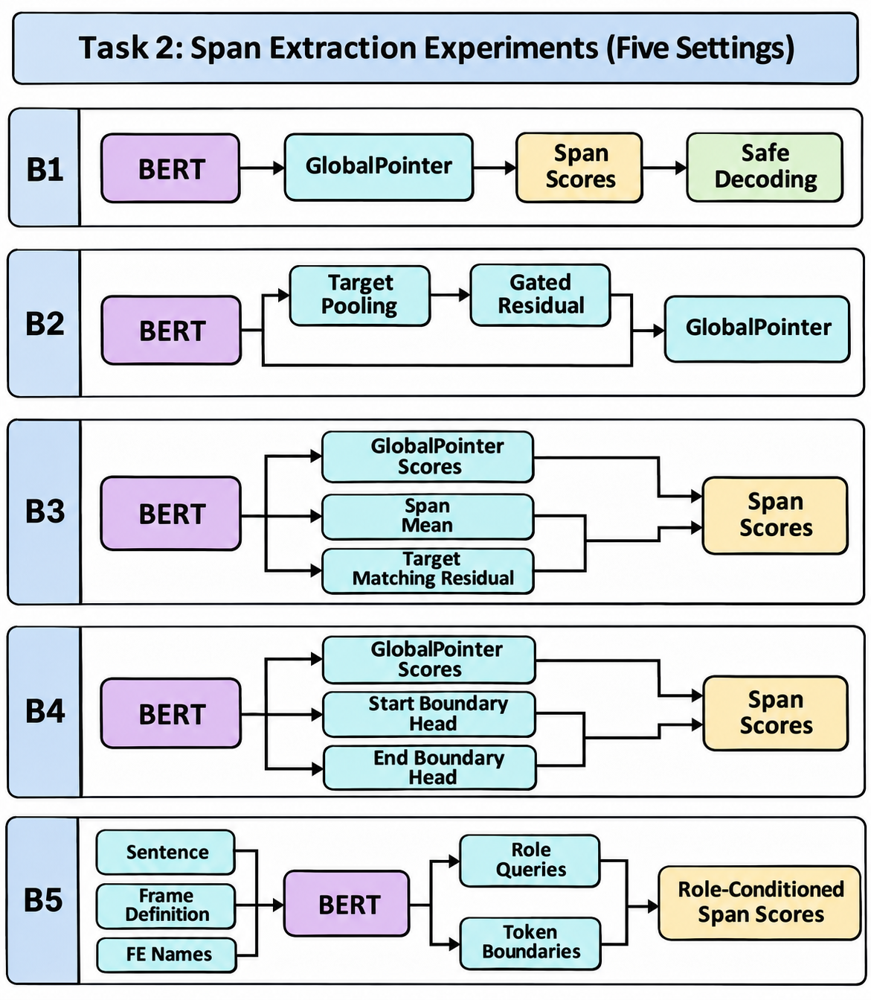
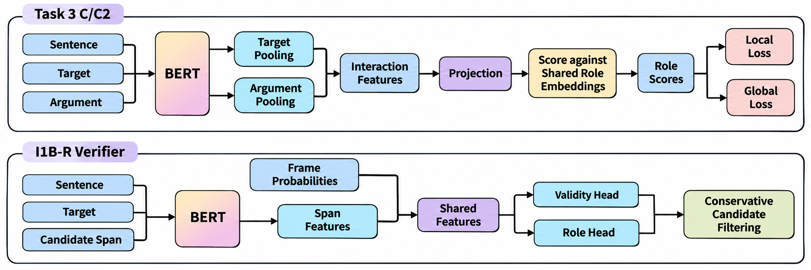

# 项目架构与实验

本页依据原实验总结和代码整理，保留单模型、集成与负实验。百分比为记录值；除明确标注线上外均为 Dev。实验未在本次整理中重新训练，且最终系统所需权重和部分缓存未分发。

## 整体流程

给定句子和目标词 Target，Task 1 预测被激活的 Frame；Task 2 找出句子中的论元边界；Task 3 为候选论元分配该 Frame 的语义角色。Task 3 面对上游预测误差，因此需要区分 Gold 条件下的模型能力与完整流水线指标。

## Task 1：Frame Identification

**Baseline / A0。** BERT 最后四层平均表示经 Frame-specific Q/K 和 RoPE，在 Target 起止位置计算 713 类 logits。修复训练时 global step 重复推进的问题后，记录中的 Dev Accuracy 从 69.43% 到 73.52%。实现：`tasks/task1/model.py`、`train.py`。

**A1 Target-aware。** 拼接 `[CLS]`、Target 起点、终点和区间平均表示，经 LayerNorm、Dropout 和线性层分类，减少对所有 token 和 Frame 构造 Q/K 的开销。10 轮 Accuracy 73.48%，与修复后的 baseline 接近；同机三轮记录的每轮时间约 603→306 秒，峰值显存约 3934→2013 MB。Target Marker 实验为 72.74%，没有提升。

**A4/A5 Frame Prototype。** 将 Frame 名称、FE 名称及定义组织成文本，使用 BERT 构建固定原型；Target-aware 上下文向量与原型做余弦匹配。单模型 Accuracy 73.52%，未见 Frame Top-5 命中率 28.13%。将 seen logits 减去 γ=2.7 后，与 baseline 等权融合，Dev Accuracy 74.26%。`tasks/task1/prototype/` 包含原型构建、训练及分析；原型文件需重新生成。校准系数在 Dev 上选择。

## Task 2：Argument Identification

**B1 GlobalPointer 与合法 Span。** 句子和 Target 编码后，Q/K 打分得到 L×L 起止矩阵。Valid Span Mask 将损失限制在允许的候选空间，推理时用阈值和 Safe Decode 剔除非法位置并映射字符坐标。校准后 P/R/F1 为 87.52/86.96/87.24%。阈值和解码不是神经网络层。实现：`model.py`、`decoding.py`、`train.py`。

**B2 Target-conditioned。** 池化 Target 后经门控和残差注入各 token，再做 GlobalPointer。P/R/F1 为 85.15/88.87/86.97%，Recall 较高，但低于 B1；训练时间增加约 47.9%。实现：`model_target_conditioned.py`。

**B3 Content-aware。** 通过低维投影和前缀和构造候选 Span 均值，与 Target 向量匹配得到残差分数并加到端点分数。P/R/F1 为 87.92/85.99/86.95%，每轮训练时间增加约 56.9%；负实验仍可为集成提供互补信息。实现：`model_content_aware.py`。

**B4 Boundary Auxiliary。** 共享编码器后并行训练 start/end token 边界头，损失为 Span loss 加 0.1 倍边界 loss；推理时以约 0.34 的系数将边界 logits 加回 Span 分数。P/R/F1 为 89.77/85.52/87.60%，更偏向 Precision。实现：`model_boundary_auxiliary.py` 和 `analyze_boundary_residual.py`。

**B5 Frame/FE Definition Guidance。** 使用 Oracle Frame，联合编码句子、Frame 定义和 FE 名称，以 FE query 与 token 起止表示产生角色条件 Span 分数。校准后 P/R/F1 为 86.28/86.85/86.56%，Role-span F1 为 67.14%；这是 Oracle 条件下的探索，未进入所述最终 Span 集成。实现：`model_frame_guided.py`、`train_frame_guided.py`。

**集成。** 对 B1–B4 分别减去各自最优阈值，再以 0.4/0.2/0.2/0.2 融合，最终阈值 -0.34。记录的 Dev P/R/F1 为 87.69/88.26/87.98%，线上 F1 为 85.85%。模型与阈值均依赖具体 checkpoint；不可把该数值视为新数据上的保证。

## Task 3：Argument Role Identification

**Baseline 与 Frame 约束。** 最后四层平均表示经 role-specific Q/K，对已知 Span 的起止位置分类。原记录总参数约 205.13M。Gold Frame 的硬约束将 Role Top-1 从 74.18% 提至 81.89%，但预测 Frame 出错时硬掩码会屏蔽正确 Role；软 Frame 先验保留概率分布和全局回退。

**C/C2 Predicate–Argument Interaction。** 分别提取 Target 和 Span 的起点、终点、均值，并投影到 256 维；组合向量、逐元素乘积、绝对差以及距离和宽度特征，与共享 Role embedding 打分。C2 在 Frame-local CE 外加入 0.2 倍 Global Role CE。记录中 Role Head 从约 102.86M 降至 1.79M，总参数从 205.13M 降至 104.06M；完整 Pipeline 的 F1 从 baseline 的 59.76% 到 C 的 60.40%、C2 的 60.54%。频次分桶指 Role 而非 Frame。实现：`model_efficient.py`、`train_role_classifier.py`。

**C3 / I1B-R 候选验证器。** 将句子、Target、候选 Span 和预测 Frame 信息用于共享表示，Validity Head 判断候选有效性，Role Head 判断角色。训练时每个正样本配两个负样本（边界扰动和随机 Span），Validity 使用正样本权重 1.5；在 Dev Recall 降幅约束下保守过滤候选。记录中 6537 个候选过滤 131 个，其中 66 个边界错误、48 个角色错误和 17 个正确 Tuple；P/R/F1 由 58.22/64.00/60.97% 变为 59.15/63.71/61.35%。不同记录中的线上增量存在冲突，故不在此给出该增量。实现：`tasks/task3/verifier/`。

## 复现边界

- Task 1 使用 Accuracy；Task 2 使用 Token-overlap P/R/F1；Task 3 使用完整 `(Span, Role)` Tuple P/R/F1。上表结果的候选、checkpoint 和校准条件可能不同。
- 各实验的训练参数、模型变体和预测依赖请查对应脚本 `--help`。原型和各模型 checkpoint 需要生成或自行提供；保留的脚本中也有历史实验和服务器路径假设。
- Task 1 prototype、Task 2 Frame 引导和 Task 3 角色定义实验使用 `frame_info.json` 提供的标签知识；训练/验证/测试使用时应遵循赛事规则，避免使用测试标签调参。
- 架构图为根据原图重绘的视觉概览，细节以文字和对应代码为准。
