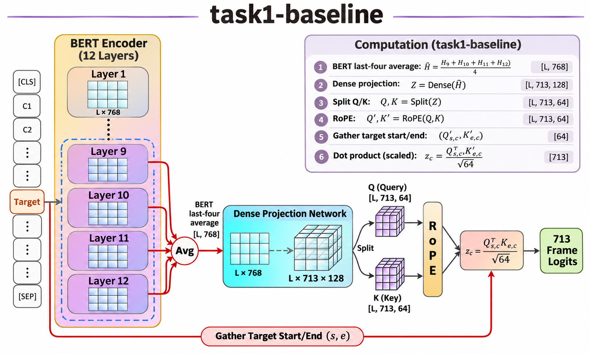
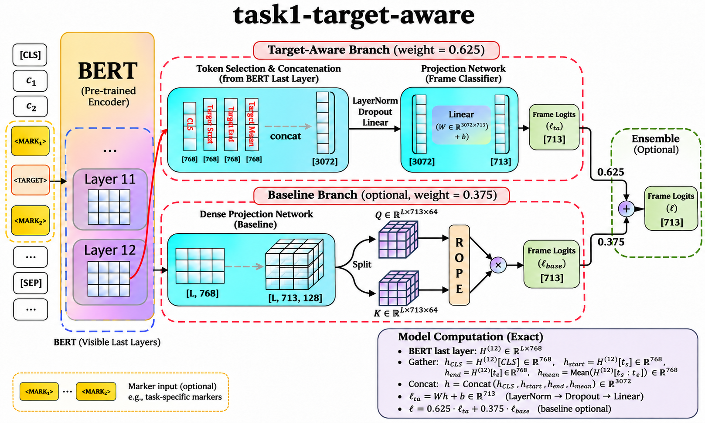
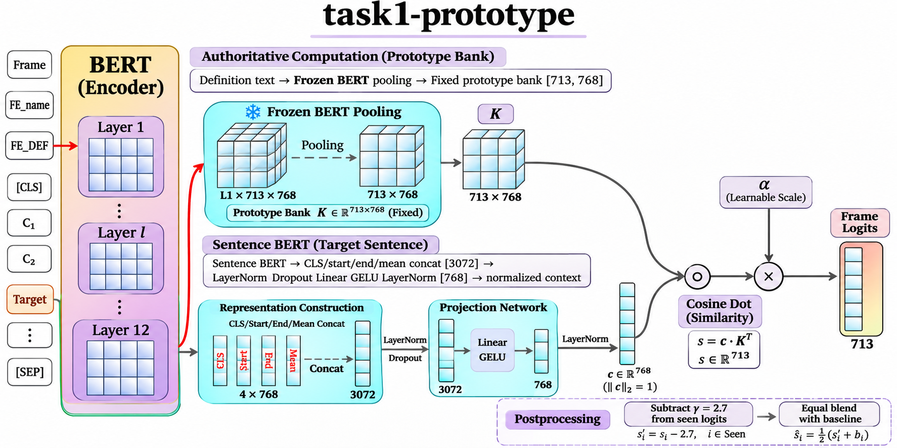
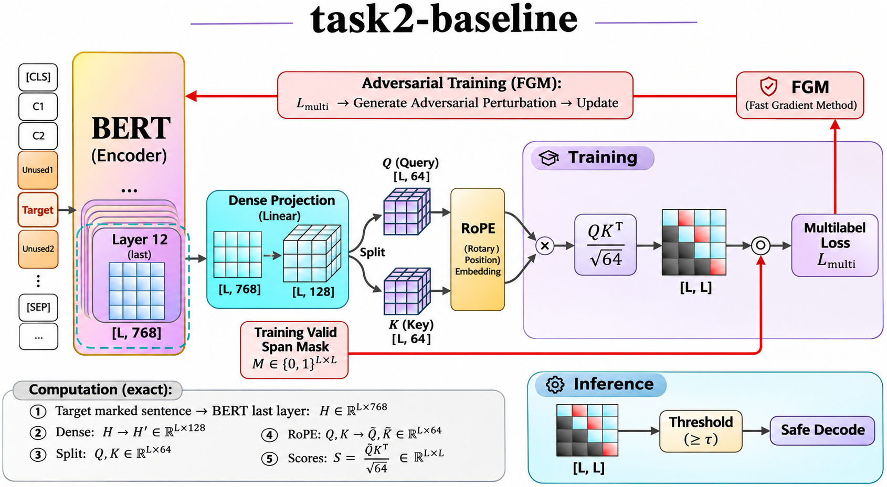
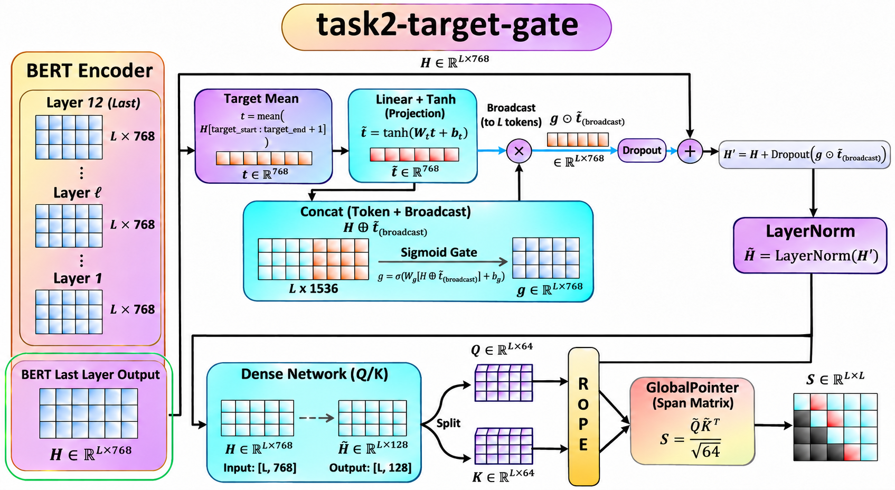
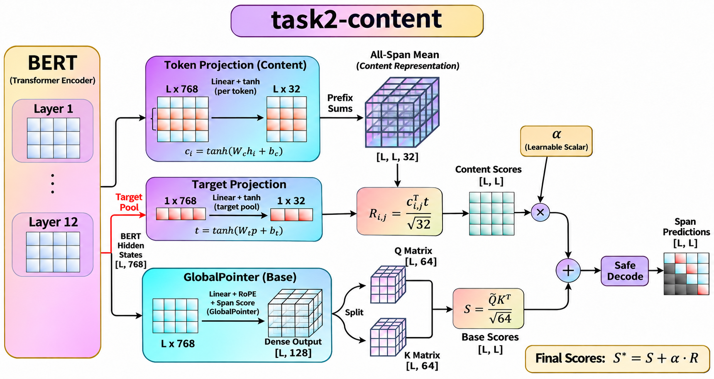
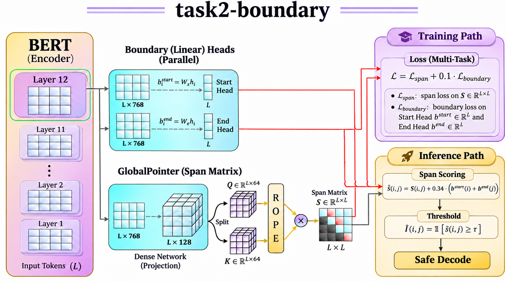
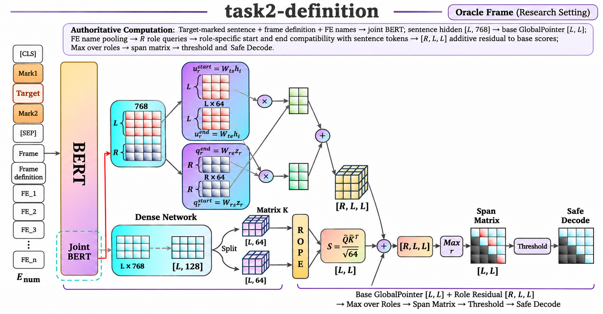
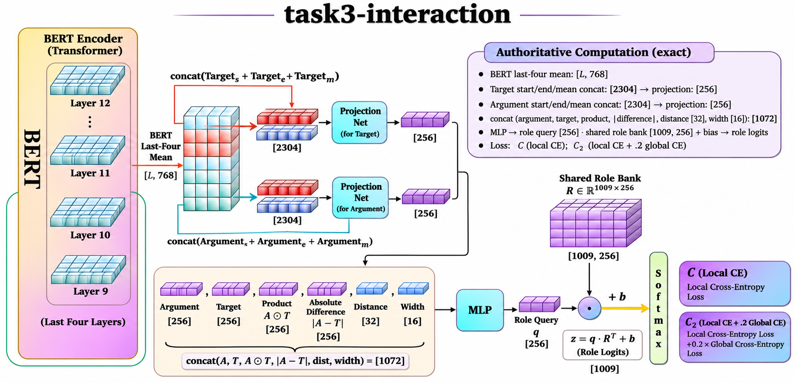
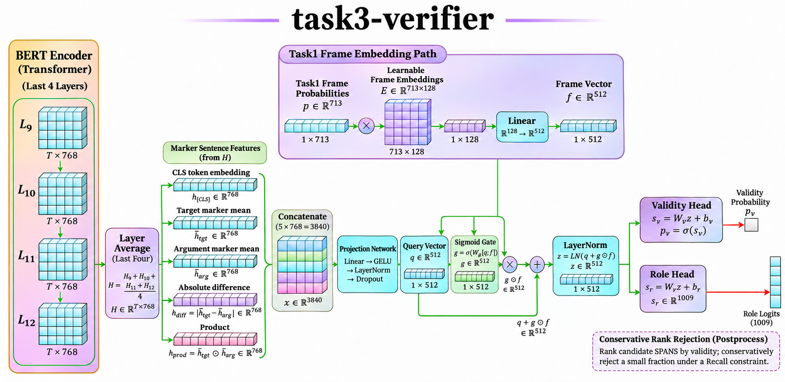

# 逐模型架构与实现

十个关键模型分别依据原始架构图重绘，并用当前代码校准张量流。图中 BERT 层、立体张量和红色条件分支延续原设计风格；下文文字解释计算和使用边界。

## Task 1 RoPE Baseline

最后四层平均 [L,768]，Dense 生成 [L,713,128]，拆成 Q/K [L,713,64]。RoPE 后只抽取 Target 起止位置做点积，输出 713 类。当前前向没有执行代码中声明的 LSTM。

代码：[实现](../tasks/task1/model.py)。

## Task 1 Target-aware

CLS、Target 起点、终点和区间均值拼成 3072 维，经过归一化、Dropout 和线性分类。Last 与 Last4 只改变 hidden 来源；Marker 是输入消融。

代码：[实现](../tasks/task1/model.py)。

## Task 1 Definition Prototype

定义编码为固定 [713,768] 原型。句子最后一层的四路池化拼接后投影为 768 维并归一化，与原型余弦匹配并乘可学习尺度。训练在 seen 标签子集计算 CE。γ 校准和基线融合属于推理。

代码：[实现](../tasks/task1/prototype/model.py)。

## Task 2 B / B1 GlobalPointer

最后一层 [L,768] 经 Dense 得到 [L,128]，拆分 [L,64] Q/K，经 RoPE 和点积构成 [L,L]。Valid Mask 约束损失，Safe Decode 负责字符坐标和非法候选过滤。

代码：[实现](../tasks/task2/model.py)。

## Task 2 D / B2 Target Gate

Target 均值经过 Linear+tanh，与每个 token 拼接算 sigmoid gate。将 dropout(gate*target_update) 残差加回 token，再 LayerNorm，最后进入原 GlobalPointer。

代码：[实现](../tasks/task2/model_target_conditioned.py)。

## Task 2 E / B3 Content

Token 和 Target 分别投影到 32 维。前缀和产生所有候选 Span 的平均内容 [B,L,L,32]，与 Target 内容点积除以 sqrt(32)，乘可学习系数后加回 GlobalPointer。下三角内容残差置零。

代码：[实现](../tasks/task2/model_content_aware.py)。

## Task 2 H / B4 Boundary

共享 hidden 并联 Start 和 End 线性头。训练增加 0.1 倍平均边界损失。H1-R 推理加入 beta*(start_i+end_j)，beta=0.34，再校准阈值；H1-R 没有额外训练 checkpoint。

代码：[实现](../tasks/task2/model_boundary_auxiliary.py)。

## Task 2 G1 / B5 Definition Query

句子与 Frame 定义、FE 名称联合编码。FE 名称池化为 query，分别与 token start/end 投影匹配，得到 [R,L,L] 角色残差并加到共享 GP 分数。Task 2 对合法角色取最大值。此实验使用 Oracle Frame。

代码：[实现](../tasks/task2/model_frame_guided.py)。

## Task 3 C/C2 Interaction

Target 与 Argument 各取 start/end/mean [2304]，各自投影为 256。拼接 a,t,a*t,abs(a-t)、距离 32 和宽度 16，得到 1072 维；MLP 到 256，与 [1009,256] 共享角色表打分。C2 增加 0.2 Global CE。

代码：[实现](../tasks/task3/model_efficient.py)。

## Task 3 I1B-R Verifier

Marker start/end 均值形成 Target 和 Argument，连同 CLS、差和乘积拼接为 3840，再投影到 512。713 维 Frame 概率加权 [713,128] 可学习嵌入，投影到 512，经过门控残差和 LayerNorm 注入。并联 Validity 和 1009 类 Role 头。

代码：[实现](../tasks/task3/verifier/model.py)。

## 系统与命名

| 展示编号 | 归档／代码实验 | 含义 |
|---|---|---|
| Task1 A0 | E1 / scheduler-fix | 调度修复 |
| Task1 A1 | E2 / target-aware | 显式 Target 表示 |
| Task1 A3 | E5 / marker | 输入标记消融 |
| Task1 A4/A5 | E6 / prototype-hybrid | 定义原型与校准融合 |
| Task2 B1/B2/B3 | B/D/E | Valid Mask、Target Gate、Content |
| Task2 B4/B5 | H/G1 | 边界辅助、定义查询 |
| Task3 C/C2 | efficient_span / calibrated | 交互分类与混合目标 |
| Task3 验证器 | I1B-R | 候选有效性与角色多任务 |

Target-aware 图中的可选 baseline 融合代表两个独立训练模型，图中共同的 BERT 符号仅用于说明编码器类型，不表示两个 checkpoint 共享一份训练参数。

Task 2 图示 B1–B5 对应归档 B/D/E/H/G1，G2 是额外固定原型条件实验。Task 3 的 model_c3.py 是 uncertainty-aware 负实验；最终验证器是 I1B-R，二者不是同一个模型。

完整系统为 Task1 baseline/prototype hybrid，Task2 B/D/E/H centered ensemble，以及 Task3 B/C2/D2 z-score 融合、自适应 soft Frame prior 与 I1B-R 小比例拒识。各模块分阶段训练和校准，不是端到端统一训练。
