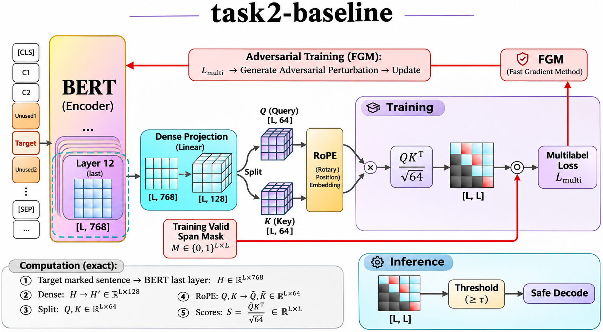
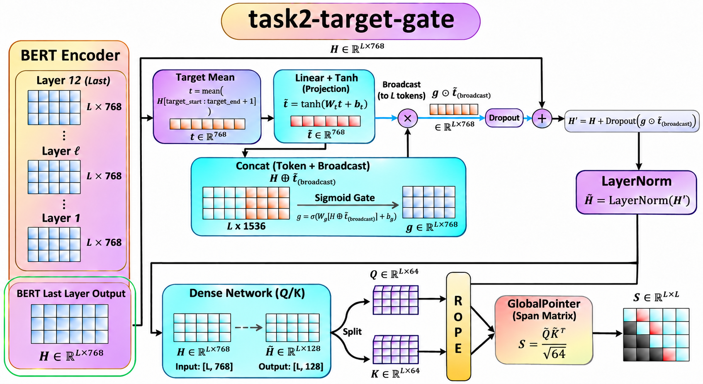
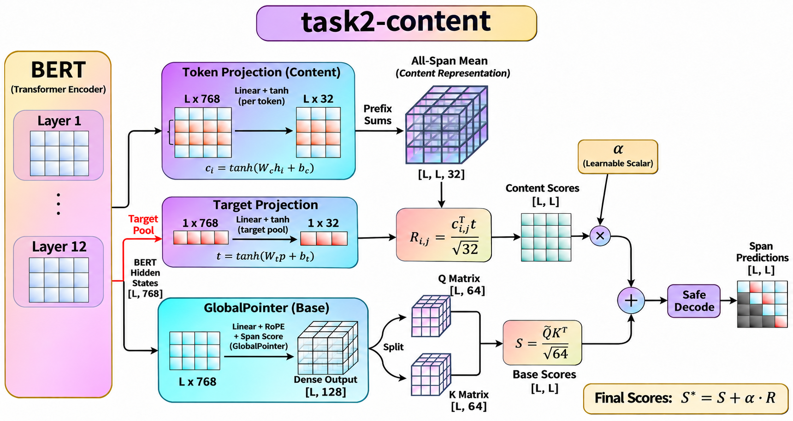
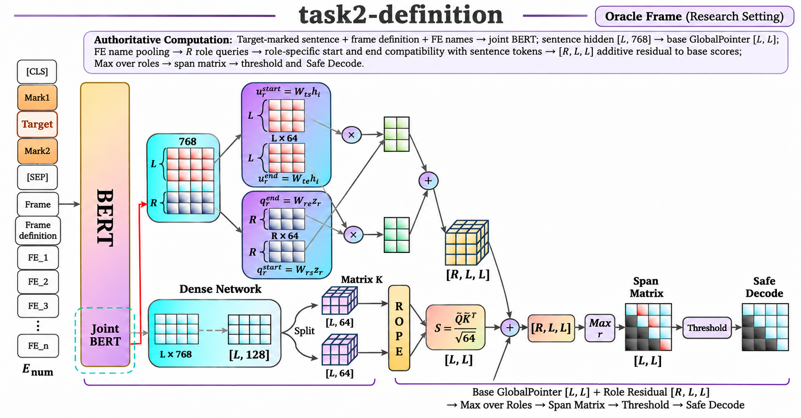
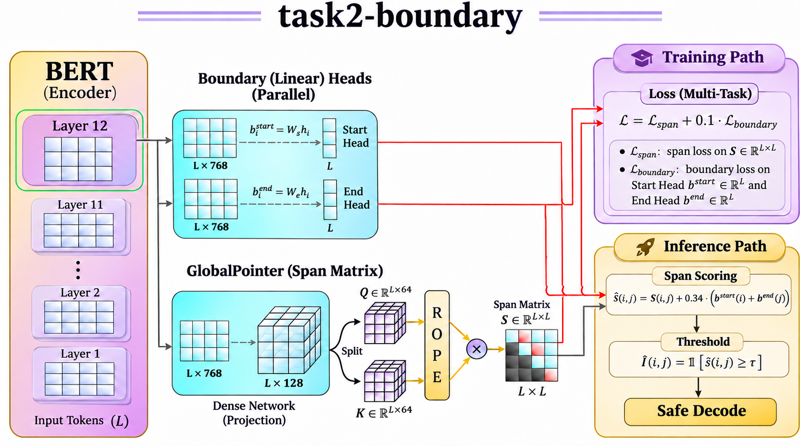

# TASK2 实验与实现详解

本文从原始实验归档整理。指标为历史记录，未在本次重新训练。不同轮数、checkpoint、Oracle 条件和校准条件分别注明。

> 阅读口径：B 是结构消融的单模型对照；后续 H1-R 在 Dev 超过 B，但线上未超过三模型集成，因此最终采用 B/D/E/H。章节按实验推进顺序保留，阶段性决定不代表最终模型选择。

## 1. 任务、数据与评价口径

### 1.1 Task2是什么

已知句子和目标词（predicate/target），Task2需要找出句子中所有论元的字符区间：

```text
输入：广东省充分利用 [目标词：毗邻] 港澳和地处亚热带的地理优势……
输出：广东省、港澳……对应的 [start,end]
```

Task2只判断“哪些位置是论元”，Task3再判断论元属于哪个 Frame Element（FE）。

### 1.2 数据结构审计

- Train：10,700 个样本，27,408 条原始 FE 标注；排除 1 条与 target 重叠的标注后为 27,407 条可用标注，按同一样本相同边界去重后为 27,391 个 Span。
- Dev：2,300 个样本，5,947 条原始标注；排除 7 条与 target 重叠的标注后为 5,940 条，按边界去重后评价矩阵中为 5,937 个 Span。
- 平均约 2.56 个论元/样本；Span 平均长度约 7.5 个字符，95 分位约 23～24。
- Train 中有 471 对 nested spans、7 对 crossing spans，且存在同一 FE 重复出现。因此不能把问题简单退化成互斥 BIO 标注，也不能使用“所有论元不得重叠”“每个角色只能出现一次”的硬约束。

### 1.3 两类指标

**Exact-span F1**：预测 `(start,end)` 必须与 gold 完全相同。它反映严格边界质量，对后续 Task3 更重要。

**Official-like Token-overlap F1**：按 README 的描述，对每个样本取预测 Span 覆盖字符位置的并集，与 gold 覆盖字符并集计算 micro P/R/F1。边界部分重叠也能获得部分分数，更接近 Task2 排行榜目标。

因此：

- Token F1 是模型选择、阈值选择和提交的主指标；
- Exact F1 是诊断指标；
- 两者最优阈值通常不同，不能混用；
- 每个模型的 logit 标定不同，必须独立搜索阈值。

### 1.4 Safe候选空间

插入两个 target markers 后，可提交 Span 只能是 target 左侧或右侧的真实句子字符，必须排除：

- `[CLS]`、`[SEP]`、Padding；
- 两个 marker；
- target自身；
- 跨越target的区间；
- `start > end` 的下三角区间。

Safe Mask由数据坐标规则直接推导，属于正确性修复，不包装为模型创新。

---

## 2. 赛事Baseline：模型、训练和问题

### 2.1 基础模型



Baseline使用 Chinese BERT-WWM-ext。Dataset在目标词两侧插入两个 unused token作为Target Marker：

```text
[CLS] sentence_left [T_START] target [T_END] sentence_right [SEP]
```

BERT输出每个字符的上下文表示 `h_i`。线性层为每个位置生成64维起点向量 `q_i` 和终点向量 `k_i`，加入RoPE位置编码后构造二维Span分数：

`score(i,j) = q_i^T k_j / sqrt(64)`

输出是 `[batch,L,L]`，每个单元格代表区间 `(i,j)` 是论元的分数。训练使用GlobalPointer风格的多标签正负集合Loss；推理时原始规则是 `logit >= 0`。

Target Marker让BERT隐式感知谓词位置，但原始GlobalPointer打分头没有显式使用target pooled vector；Dataset虽然计算了`target_cls`，Baseline也完全没有使用Frame类别。

### 2.2 Baseline的优点

1. 二维Span建模与本数据的nested/overlap结构匹配；
2. 不需要枚举BIO标签转移；
3. BERT端点已经包含双向上下文；
4. 一个矩阵即可输出任意数量论元；
5. 工程简单，适合作为所有结构实验的可靠主干。

### 2.3 Baseline暴露的问题

1. **训练/验证/提交候选空间不一致**：旧Loss和旧Eval包含特殊token、target和不可提交位置，预测阶段又用条件过滤。
2. **固定threshold=0**：没有根据官方式Token F1调参。
3. **保存指标错位**：旧代码更接近按Exact指标保存，而比赛Task2更接近Token overlap。
4. **日志不足**：原Baseline没有完整保存每轮Loss、P/R/F1、耗时、显存和配置。
5. **目标条件较弱**：目标词主要通过Marker隐式进入BERT，打分头不直接计算predicate-argument兼容性。
6. **Span显式特征不足**：打分公式显式只用端点，没有独立的内部内容、宽度或相对距离分支。
7. **Frame ontology未使用**：`frame_info.json`中的Frame定义、FE名称和FE定义没有进入Task2。
8. **FGM成本未知**：每个batch增加一次对抗前后向，但原工程没有消融和资源记录。

这些问题决定了优化顺序：先修复评价与训练一致性，再做可控消融，最后做模型创新。

---

## 3. 阶段0：不训练的坐标、指标和阈值优化（2026-08-17）

### 3.1 完成的工程工作

- 全量数据/坐标检查；
- Safe Span Mask与Safe Decode；
- 同时计算Exact与Token-overlap P/R/F1；
- 完整threshold grid；
- 训练日志、CSV、config和checkpoint目录规范化；
- 去掉`output_hidden_states=True`但只使用最后一层的无效开销，不改变数学输出。

### 3.2 旧checkpoint阈值结果

最终的完整Token-union实现下：

| 设置 | Token P/R/F1 | Exact F1 | 解释 |
|---|---:|---:|---|
| Safe threshold=0 | 88.04 / 84.53 / **86.2485** | 77.6107 | 偏保守 |
| Token最优threshold=-0.61 | 84.812 / 89.166 / **86.9346** | 约76.5 | 主动增加部分重叠Span |
| Exact最优threshold=0.4 | Token F1约85.78 | **77.8500** | 更保守、边界更严格 |

Token最优阈值约-0.6，相对0提升约0.69点；实际用-0.6生成提交后，线上Task2约提升0.6点。这是第一个“零训练成本”的有效改进。

### 3.3 结论

负阈值增加Recall，虽然会降低Exact边界质量，却更符合Token overlap计分。阈值是模型的一部分，不能把一个模型的最优阈值直接复制给另一个模型。

---

## 4. 阶段1：A/B/C训练与工程消融（2026-08-18）

三组统一为5 epochs、batch size 3、lr 2e-5、seed 42，并同时保存Token-best和Exact-best。

| 实验 | Valid Loss Mask | FGM | Token-best@0 | Exact-best@0 | 目的 |
|---|---:|---:|---:|---:|---|
| A | 否 | 是 | 86.6266%（E4） | 77.2931% | 新日志体系下复现旧训练方式 |
| B | 是 | 是 | **87.0839%（E3）** | **77.3463%（E5）** | 测Valid Mask |
| C | 是 | 否 | 86.3031%（E5） | 76.7041% | 测FGM |

### 4.1 A→B：Valid-span Loss Mask

- Token F1：+0.4574点；
- Exact F1：+0.0532点；
- 收益主要来自Precision，说明减少了不可能提交位置的负样本噪声；
- 结论：后续所有Task2训练固定保留Valid Mask。

### 4.2 C→B：FGM

- Token F1：+0.7809点；
- Exact F1：+0.6422点；
- 同服务器平均每轮：304.78秒→365.73秒，约+20%；
- 峰值显存：2007.28MB→2486.10MB，+478.83MB；
- 结论：在5轮预算中，FGM收益足以覆盖成本，后续主实验保留。

FGM的通用依据来自Goodfellow et al. (2015)的对抗训练，以及Miyato et al. (2017)在文本embedding空间中的对抗训练；其在本项目中的保留最终由B/C实证消融决定。

### 4.3 B阈值校准与最终单模型

B的Token-best为E3：

```text
threshold=0:    P/R/F1=88.4692/85.7413/87.0839
threshold=-0.26 P/R/F1=87.5186/86.9615/87.2391
```

校准收益+0.1552点。B成为后续所有模型创新的对照和warm-start来源。

---

## 5. 阶段2：D——Target-conditioned GlobalPointer

### 5.1 问题与文献动机

同一文本片段相对于不同谓词可能是论元，也可能不是。Baseline仅用Marker隐式提示目标词，打分头没有显式predicate-argument交互。

参考动机：

- Ouchi et al. (2018)：直接对每个predicate评分候选argument spans；
- Shi & Lin (2019)：predicate-aware BERT是强SRL基线；
- He et al. (2017)：长距离predicate-argument依赖和argument identification是SRL关键问题。

D是受上述方向启发的轻量适配，不是对某篇论文的完整复现。

### 5.2 加入的组件



对Target Marker之间的字符做mean pooling得到`p`：

```text
g_i = sigmoid(W_g [h_i;p])
h'_i = LayerNorm(h_i + g_i * W_p p)
```

再用`h'_i`生成GlobalPointer的q/k。二维Span矩阵、Valid Mask、FGM和解码全部保留。

### 5.3 结果

| 指标 | B | D | D-B |
|---|---:|---:|---:|
| Token F1@0 | 87.0839 | 86.2760 | -0.8079 |
| 校准Token F1 | **87.2391**（-0.26） | 86.9721（-0.75） | -0.2671 |
| Exact-best@0 | 77.3463 | 77.3503 | +0.0040，持平 |

D的E1收敛快于B，但最终平台更低。校准需要更负的-0.75，说明分数明显偏保守。

同服务器观测：每轮540.88秒，相对B约+47.89%；峰值显存只+28.20MB，主要成本来自对所有token执行大门控线性层且FGM重复前向。

### 5.4 结论

Target Marker已经让BERT隐式编码目标位置；将同一个target vector强广播到所有token会提供易学习的快捷信号，但可能同质化token表示、降低最终Recall。D不替代B，但证明“强全局注入位置”不合适，并保留为互补集成成员。

---

## 6. 阶段3：E——Additive Content-aware Span Scorer

### 6.1 问题与文献动机

D说明不应强改写全部token；E转而补充GlobalPointer显式缺少的Span内部内容。

- Ouchi et al. (2018)：span-based SRL可显式使用span-level features；
- Lee et al. (2017)：边界+span内部表示+宽度是成熟的Span表示设计（跨任务架构借鉴，论文任务是共指）；
- Swayamdipta et al. (2017)：将FrameNet argument作为完整segment建模。

### 6.2 加入的组件



将token投影到32维，通过prefix sum一次构造所有Span mean：

```text
z_t = tanh(W_c h_t)
m_ij = mean(z_i...z_j)
u = tanh(W_p mean(h_target))
s_content(i,j)=m_ij^T u/sqrt(32)
s_final=s_GP + alpha*s_content
```

`alpha`为可学习标量，初始化0.1。新增参数约0.05M，但训练会构造`B×L×L×32`张量。

### 6.3 结果

| 指标 | B | E | E-B |
|---|---:|---:|---:|
| Token F1@0 | 87.0839 | 86.8671 | -0.2168 |
| 校准Token F1 | **87.2391**（-0.26） | 86.9473（-0.20） | -0.2918 |
| Exact-best@0 | 77.3463 | 77.2876 | -0.0587 |

`content_scale`由0.1000升到0.10785，Smoke Test也有非零梯度，说明内容分支确实被使用，而不是失效。

同服务器观测：每轮573.90秒，相对B约+56.92%；显存只+41.44MB。E属于“参数轻量、计算不轻量”。

### 6.4 结论

BERT端点本身已是双向上下文化表示，简单Span mean与端点信息高度冗余；mean还会稀释长Span中的关键内容。E更像保守过滤器，Precision略高但Recall不足。停止扩大content维度或盲目叠加width/distance，但保留E用于集成。

---

## 7. 阶段4：B/D/E Centered-logit集成

### 7.1 为什么不能直接平均

三个模型的独立最优阈值分别为：

```text
B=-0.26, D=-0.75, E=-0.20
```

原始logit尺度和零点不同。直接平均会让标定偏移最大的模型错误主导。先中心化：

`centered_score_m = raw_score_m - threshold_m`

再搜索模型权重和最终阈值。

### 7.2 结果

| 方案 | 权重 B/D/E | 最终阈值 | Token P/R/F1 | 相对B |
|---|---|---:|---:|---:|
| B | 1/0/0 | 0 | 87.5186/86.9615/87.2391 | - |
| B+D | 0.70/0.30/0 | -0.18 | 86.4895/88.7411/87.6008 | +0.3617 |
| B+E | 0.75/0/0.25 | -0.28 | 87.0734/88.3314/87.6979 | +0.4587 |
| **B+D+E** | **0.40/0.20/0.40** | **-0.16** | **87.8716/87.6355/87.7533** | **+0.5142** |

最优集成覆盖45,282个字符，gold为45,404，仅少0.27%，P/R高度平衡。它不仅换取Recall，Precision也高于B。

按此配置生成提交后，线上Task2约提升0.12点。Dev收益缩小，说明Test-B互补性弱于Dev，或权重/阈值存在一定Dev适配；因此不继续高维精调。

### 7.3 结论

D/E作为单模型是负结果，但与B错误不完全重合，产生了实际集成价值。模型研究不能只看“是否替代最佳单模型”，也应看错误多样性。

---

## 8. 阶段5：Frame/FE知识审计与G系列

### 8.1 为什么启动G

A-E均没有真正使用FrameNet最核心的信息：Frame定义、FE名称和FE定义。`frame_info.json`包含713个Frame，每个Frame对应一个定义和多个FE语义角色；它不是“一个Frame对应多个激活词”的表。

直接相关文献：

- Zheng, Wang, Chang (2022), AGED：`text + frame definition`，用定义中的FE mentions作为query生成start/end pointers；
- Conia et al. (2022)：用自然语言定义描述predicate-argument结构，支持Definition Modeling for SRL；
- Das et al. (2014)：经典Frame Semantic Parsing完整体系和结构推断。

### 8.2 可行性分析

- Gold Frame平均将全局1009个FE名称缩小到约43.21个候选；
- Task1 Baseline top5 Frame recall约90.17%，其FE集合覆盖约95.43%的gold FE mentions；
- Baseline top5与Prototype top5并集：Frame recall约91.87%，gold FE mention coverage约96.22%；
- `句子 + frame name + frame definition + FE names`平均约297.55字符，P95=458，约2.26%超过512，可只截断定义正文而保留全部FE slots；
- 拼接所有完整FE definitions平均约1688字符，100%超过512，因此不能简单全部串联。

### 8.3 G0：工程MVP

输入：

`[CLS] target-marked sentence [SEP] frame_name + frame_def + all FE names [SEP]`

BERT联合编码句子与定义。每个FE名称池化为query；在B的GlobalPointer分数上增加role-specific start/end兼容项：

`s(r,i,j)=s_GP(i,j)+alpha*(start(q_r,h_i)+end(q_r,h_j))`

输出由`[B,L,L]`扩展到`[B,R,L,L]`，以支持重复FE、nested和overlap。G0前后向、坐标、长度、梯度和B权重兼容全部通过。

数据侧还发现训练标注`图形/fig`与ontology规范名`焦点图形/fig`不一致，最终按稳定`fe_abbr`做别名映射，而不是错误地创建两个FE。

### 8.4 G1：Definition-guided Role-query GlobalPointer



G1从B Token-best warm-start，使用Oracle/Gold Frame，主干lr=1e-5、新role head lr=5e-5，FGM，5轮。Task2分数取所有FE role logits的最大值，同时记录role-span F1。

| 指标 | threshold=0 | 校准后 |
|---|---:|---:|
| Token P/R/F1 | 90.6887/77.1166/83.3538 | 86.2791/86.8492/**86.5632**（-1.13） |
| Role-span F1 | **67.14%** | 未单独校准 |

阈值校准带来+3.2094点，说明role-specific训练使logit整体下移，threshold=0的低Recall不能完全解释为表征失败。但在使用正确Frame的有利条件下，G1仍比B低0.6759点。

同服务器相对B：耗时+31.96%，显存从2486MB升至4099MB（+64.86%）。G1技术结构有效、角色分支确实学习，但Task2收益/成本不成立。

G1应准确描述为“受AGED启发、适配重叠多Span的Definition/FE-name Role-query GlobalPointer MVP”，不是完整AGED复现，因为没有将每个FE的完整`fe_def`全部作为query训练组件。

### 8.5 G2：Fixed Frame Prototype-conditioned GlobalPointer

G2不拼接长定义，直接复用Task1预计算的713个Frame Prototype。根据Gold Frame选取向量`p_f`，加入轻量start/end残差：

`s(i,j)=s_GP(i,j)+beta*(start(p_f,h_i)+end(p_f,h_j))`

| 指标 | threshold=0 | 校准后 |
|---|---:|---:|
| Token P/R/F1 | 88.3462/84.6511/86.4592 | 87.1615/86.7699/**86.9653**（-0.50） |

校准后仍比B低0.2739点；`frame_scale`从0.1到0.0991，几乎未增强。单个全局Frame向量无法直接回答具体边界在哪里。

### 8.6 G系列结论

1. Frame/FE语义更适合角色分类，而不是直接替代无角色的Task2边界模型；
2. G1证明Role-query能够学习语义角色，但多role负样本和共享基础分数会改变Task2标定；
3. G2证明只有全局Frame语义不足以定位边界；
4. G1/G2都使用Oracle Frame，真实Test-B还会引入Task1错误传播；Oracle上限尚未超过B，因此不开发排行榜推理链路；
5. G作为主模型创新和负向实验完整归档，G1结构保留给Task3或未来统一解析。

---

## 9. 阶段6：H1 Boundary Auxiliary Supervision 与 H1-R

### 9.1 从G得到的新问题定义

Frame语义对边界过于间接，而Task2的核心误差是起点/终点和覆盖字符。H1转向与主指标更直接一致的边界辅助监督。

文献动机：

- Ouchi et al. (2018)和He et al. (2017)：SRL核心仍是predicate-conditioned argument span identification；
- Li et al. (2020) MRC-NER：start/end与Span matching联合建模可处理多Span和嵌套实体。此处是跨任务结构借鉴，不宣称为SRL论文复现。

### 9.2 加入的组件



```text
BERT shared hidden states
 ├─ 原GlobalPointer [L,L] 主分支
 ├─ Start Boundary token head
 └─ End Boundary token head
```

标签由现有Span矩阵直接投影：

```text
start_label[i] = any_j span_label[i,j]
end_label[j]   = any_i span_label[i,j]
```

Loss：

`L = L_span + lambda * 0.5*(L_start+L_end)`，H1取`lambda=0.1`。

H1首版只用边界头提供训练梯度，不把边界logits直接加入最终Span分数，因此：

- 初始化Span logits与B严格相同；
- 不改变Safe Decode和提交格式；
- 仍由GlobalPointer支持multiple/nested/overlap；
- 复杂度约`O(BLH)`，远低于E的`O(BL²d)`内容张量。

配置：从B Token-best warm-start；主干lr=1e-5，新边界头lr=5e-5；Valid Mask、FGM、关闭legacy parameter noise、5 epochs、seed 42。

### 9.3 Smoke Test

```text
max_logit_difference_from_B=0.0
loss_identity_difference=0.0
missing_from_B=4（仅start/end两个Linear）
四个新参数梯度均有限且非零
```

### 9.4 五轮训练与过拟合诊断

Token-best、Exact-best和最小Val Loss均在epoch 1：

| Epoch | Token F1@0 | Exact F1@0 | Start F1 | End F1 | Val Span Loss | Val Boundary Loss |
|---:|---:|---:|---:|---:|---:|---:|
| 1 | **86.8104** | **77.4689** | 82.9858 | 83.1279 | **3.1217** | **2.0934** |
| 2 | 85.3957 | 76.6765 | 82.8031 | 83.1995 | 3.1891 | 2.1296 |
| 3 | 85.7751 | 76.5115 | 82.8873 | 83.1175 | 3.9426 | 2.4484 |
| 4 | 86.3197 | 76.7007 | 82.8547 | 83.1836 | 4.4039 | 2.6450 |
| 5 | 86.2511 | 76.6162 | 82.8625 | 83.1300 | 4.7607 | 2.7776 |

训练Total/Span/Boundary Loss分别由1.7547/1.5414/2.1324降至
0.7873/0.7075/0.7988，而验证三项Loss持续恶化。边界F1稳定约83%，但没有随
训练提升。因此从已训练B继续全参数微调五轮明显过长，后续只使用epoch-1
checkpoint。

### 9.5 H1纯Span分支校准

独立精搜得到threshold=-0.37，Token P/R/F1为
86.7789/87.3007/**87.0390%**，相对B低0.2001点。结论是：辅助头学会了
边界，但仅靠共享表征迁移并没有提高GlobalPointer主分支。

### 9.6 H1-R：将边界证据直接加入Span打分

为了在训练H2前验证机制，先做不改权重的离线残差搜索：

```text
s(i,j) = s_span(i,j) + beta * (s_start(i) + s_end(j))
```

精搜最优为beta=0.34、safe threshold=0.53：

```text
Token P/R/F1 = 89.7723 / 85.5233 / 87.5963%
Exact F1 = 77.2377%
```

它相对H1纯Span提高0.5573点，相对B提高0.3572点，仅比B/D/E低0.1570点。
正beta清楚证明边界头包含有效且可用于决策的信号。H1纯辅助失败的根因是
“训练了边界、推理却丢弃边界”，而不是Start/End建模方向错误。

### 9.7 H系列决定

1. H1纯辅助版本作为负向消融保留；
2. H1-R当时作为 Dev 最佳单 checkpoint 方案，随后完成线上验证，见下一节；
3. 先做B/D/E/H互补性分析，再决定是否需要训练H2；
4. 如训练H2，使用zero-init gate、1--2轮和更小主干LR，避免重复五轮过拟合。

### 9.8 H1-R线上验证与B/D/E/H修正

H1-R线上P/R/F1由原B/D/E的86.4325/84.9234/85.6713变为
88.2232/82.0675/85.0341：Precision提高1.7907点，但Recall下降2.8559点，
最终F1下降0.6372点。边界头确实会过滤错误Span，但Test-B上的过滤强度超过
Dev预期。

四模型centered-logit搜索得到：

```text
B/D/E/H=0.40/0.20/0.20/0.20
centers=-0.26/-0.75/-0.20/0.53
H beta=0.34
final threshold=-0.34
Dev P/R/F1=87.6948/88.2587/87.9759%
```

相对B/D/E，Dev上P -0.1768、R +0.6233、F1 +0.2225点。线上得到
P/R/F1=86.1772/85.5163/85.8455%，相对原B/D/E为P -0.2553、R +0.5929、
F1 +0.1742点。Dev与线上变化方向及幅度接近，边界专家的集成收益成立。

### 9.9 是否进入H2

**不将H2作为下一步主线，Task2排行榜路线暂时封板。**

依据：

1. H的有效性已经由线上B/D/E/H +0.1742点证明，不需要再用完整训练验证方向；
2. H1在epoch 1后显著过拟合，继续联合训练存在已观察到的风险；
3. H1-R单模型线上F1下降0.6372点，说明Dev学习/校准的边界强度不能直接泛化；
4. 当前centered ensemble已通过`H weight=0.2`和最终阈值实现可控gate功能；
5. H2最多期望改善单模型或轻微替代人工beta，未必超过四模型集成，机会成本高；
6. 项目仍有Task3优化，当前应把主要训练预算转到Task3。

H2 仅作为未执行的后续研究设想，需使用 zero-init gate、
1--2 epochs、更低主干LR和epoch级早停，不能再跑默认五轮。

---

## 10. 全部实验统一结果表

### 10.1 模型与性能

| 阶段 | 实验 | 核心变化 | Token F1@0 | 校准后Token F1 | 相对校准B | 结论 |
|---|---|---|---:|---:|---:|---|
| 0 | 旧Baseline checkpoint | 原模型，仅调阈值 | 86.2485 | 86.9346（-0.61） | -0.3045 | 阈值线上+约0.6 |
| 1 | A | 旧Loss区域+FGM | 86.6266 | 未精搜 | - | 控制基线 |
| 1 | **B** | Valid Mask+FGM | 87.0839 | **87.2391（-0.26）** | 0 | 最佳单模型 |
| 1 | C | B去掉FGM | 86.3031 | 未精搜 | - | FGM有效 |
| 2 | D | Target-conditioned Gate | 86.2760 | 86.9721（-0.75） | -0.2671 | 收敛快、上限低 |
| 3 | E | Span Content Residual | 86.8671 | 86.9473（-0.20） | -0.2918 | 内容与端点冗余 |
| 4 | **B/D/E** | Centered-logit ensemble | - | **87.7533** | **+0.5142** | 阶段性三模型方案 |
| 5 | G1 | Definition/FE Role-query | 83.3538 | 86.5632（-1.13） | -0.6759 | 角色有效，Task2无增益 |
| 5 | G2 | Fixed Frame Prototype | 86.4592 | 86.9653（-0.50） | -0.2739 | Oracle仍不如B |
| 6 | H1 | Start/End辅助监督，仅Span推理 | 86.8104 | 87.0390（-0.37） | -0.2001 | 边界学会但主分支过拟合 |
| 6 | **H1-R** | H1边界残差直接参与Span打分 | - | **87.5963（beta=0.34, q=0.53）** | **+0.3572** | 最佳单checkpoint推理 |
| 7 | **B/D/E/H** | Centered集成+H边界残差 | - | **87.9759** | **+0.7367** | 线上F1 85.8455；相对B/D/E +0.1742 |

### 10.2 资源与性价比

| 实验 | 平均秒/epoch | 峰值显存 | 相对B观察 | 性价比结论 |
|---|---:|---:|---|---|
| B | 365.73 | 2486MB | 基准 | B 基准模型 |
| C | 304.78 | 2007MB | 无FGM节省约16.7%实际时间 | 性能损失较大 |
| D | 540.88 | 2514MB | 时间+47.89% | 不成立 |
| E | 573.90 | 2528MB | 时间+56.92% | 参数轻、计算重 |
| G1 | 482.63 | 4099MB | 时间+31.96%，显存+64.86% | 不成立 |
| G2 | 580.86（本地） | 2490MB | 与B不在同机，时间不比较 | 显存轻量 |
| H1 | 558.87（本地） | 2471MB | 与B不在同机，时间不比较 | epoch 1后过拟合；推理残差有效 |

---

## 11. 文献—组件—实际实现对应关系

| 文献 | 可借鉴关键点 | 本项目对应实验 | 实际覆盖程度 |
|---|---|---|---|
| Ouchi et al., 2018 | predicate-conditioned span selection、span features、结构选择 | Baseline/D/E/H | Baseline覆盖二维Span枚举；D/E/H分别做局部扩展，未复现完整结构解码 |
| He et al., 2017 | SRL深层模型、argument identification误差、长距离依赖 | D/H动机 | 任务与误差分析依据，不是模型复现 |
| Shi & Lin, 2019 | predicate-aware BERT SRL | D | 只借鉴显式predicate conditioning动机 |
| Lee et al., 2017 | boundary+span content+width、pruning、高阶交互 | E | 只实现轻量mean-content，属于跨任务局部借鉴 |
| Swayamdipta et al., 2017 | FrameNet segment整体建模、syntactic scaffold | E/后续结构方向 | 只借鉴segment动机，未实现segmental RNN/scaffold |
| Li et al., 2020 | start/end+span matching，多Span/嵌套 | H | 跨任务借鉴Start/End辅助头；H1暂不改解码 |
| Das et al., 2014 | 完整Frame Semantic Parsing和结构推断 | G/Task1-3体系 | 任务体系依据 |
| Zheng et al., 2022 AGED | text+definition、FE query、start/end pointers、role interaction | G1 | 最直接结构来源；适配为多标签Role×Span矩阵 |
| Conia et al., 2022 | 用自然语言定义描述predicate-argument结构 | G | Definition Modeling依据 |
| Goodfellow et al., 2015；Miyato et al., 2017 | 对抗训练、文本embedding扰动 | A/B/C及后续 | FGM保留由B/C消融实证支持 |

技术说明原则：明确区分“论文直接组件”“任务动机”“跨任务结构借鉴”，不把局部启发包装成完整复现。

---

## 12. 从实验序列得到的研究结论

### 12.1 有效结论

1. **目标一致性优先于模型复杂度**：Valid Mask、Token-best保存和阈值校准的收益稳定、成本低。
2. **FGM在本数据有效**：+0.7809点，虽增加约20%时间，仍应保留。
3. **模型分数必须独立校准**：D和G1在threshold=0看似严重低Recall，负阈值可恢复大量性能。
4. **负向单模型也可能有集成价值**：D/E均低于B，但centered ensemble提升0.5142点。
5. **全局语义不等于局部边界信息**：Target强广播、Span均值、Frame Prototype都没有提高上限。
6. **Frame定义更适合角色语义**：G1 Role F1持续上升，但Task2并未受益；应将该结构迁移给Task3而非继续压Task2。
7. **工程成本必须量化**：D/E/G1都增加明显训练成本，却没有单模型收益，及时停止避免浪费GPU预算。
8. **训练目标必须进入推理解码**：H1边界头约83% F1却未改善纯Span分支；把Start/End分数直接加入Span后，Token F1从87.0390%升至87.5963%。
9. **Dev提升必须经线上P/R拆分验证**：H1-R线上Precision明显提高但Recall损失更大；只报告Dev F1会掩盖分布偏移。

### 12.2 失败实验并非无效

- D回答了“显式Target是否应强注入全部token”：当前Gate过强，不应继续；
- E回答了“简单Span mean是否补足端点”：与BERT上下文化端点冗余；
- G1/G2回答了“Frame ontology能否直接改善边界”：Oracle条件仍无净收益，但G1可帮助Role建模；
- H1回答了“仅靠辅助梯度能否改善Span主分支”：不能稳定改善，而且五轮增量训练过拟合；
- H1-R进一步确认边界信号本身有效，后续应显式耦合边界与Span分数，而不是只加辅助Loss。
- H1-R线上失败回答了“边界残差能否单独替代Span集成”：不能；它应作为低权重Precision专家，由B/D/E补回Recall。

---

