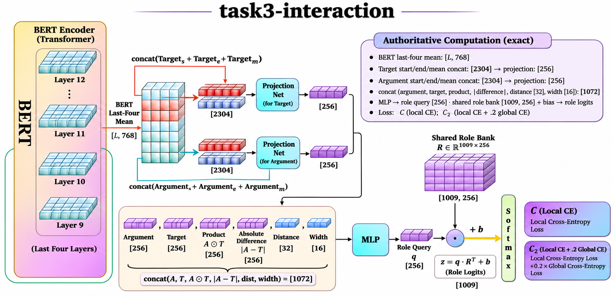
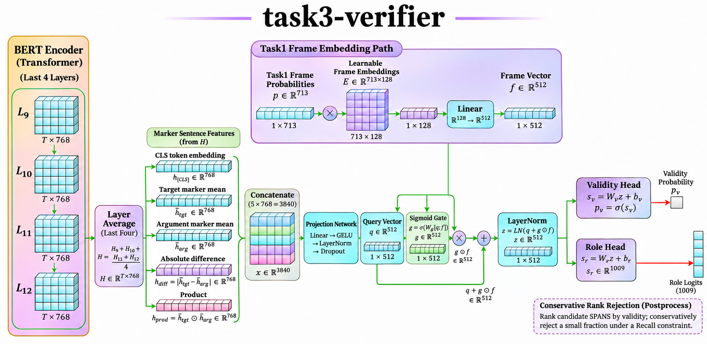

# TASK3 实验与实现详解

本文从原始实验归档整理。指标为历史记录，未在本次重新训练。不同轮数、checkpoint、Oracle 条件和校准条件分别注明。

> 命名说明：本页 C3 指 model_c3.py 的 uncertainty-aware 实验；PPT 中末页的“C3 验证器”在代码中叫 I1B-R，位于 verifier/。Role-specific Dense 只针对 1009 个 Role 生成 Q/K，不是 Frame×Role 组合头。102.86M 是全部非 BERT 参数，99.32M 是 Dense 本身。

## 4.1 任务定义与 baseline

Task3 输入：句子、Target 和一个已知论元 Span。输出：该 Span 的 FE Role。

完整 Pipeline 中，Task2 先给候选 Span，Task3 再给 Role；最终评价的是完整 Tuple：

```text
(instance_index, argument_start, argument_end, FE_role)
```

### Baseline 前向

```text
句子 + Target marker
      ↓
BERT 最后四层平均，H ∈ R^{B×L×768}
      ↓
Target/Argument 已知边界
      ↓
Target span pooling + Argument span pooling
      ↓
Dense(768 → 713×1009×? 的超大角色头)
      ↓
角色 logits [B,1009]
      ↓
argmax Role
```

当前 Baseline 的真实参数：

| 项目 | 数值 |
|---|---:|
| BERT Encoder | 102.27M |
| Dense Role Head | 99.32M |
| 总参数 | **205.13M** |
| Dense 占总参数 | 48.42% |
| 全局 FE 类别 | 1009 |
| Frame 数量 | 713 |
| 每个 Frame 合法 FE 平均 | 42.70 |

### Baseline 的问题

1. 角色头把 1009 个 FE 当作完全平等、互不相关的离散 ID；
2. 没有显式建模 Predicate/Target 与 Argument Span 的交互；
3. 已知 Frame 的合法 FE 候选没有被充分利用；
4. 同一边界可能有多个 Role，单标签分类存在理论上限；
5. 训练使用 Gold Span，推理接收 Task2 的错误 Span，存在 train–test mismatch；
6. 普通全局 Role 分类对长尾和未见 FE 缺少语义迁移能力。

### Task3 代码地图

| 作用 | 文件 |
|---|---|
| Gold Span/Role 数据构造 | `tasks/task3/dataset.py` |
| 原始 role classifier | `tasks/task3/model.py` |
| Efficient Span C | `tasks/task3/model_efficient.py` |
| C3 uncertainty/frame residual | `tasks/task3/model_c3.py` |
| Definition Prototype D/D2 | `tasks/task3/model_definition.py` |
| Frame 定义预计算 | `tasks/task3/build_definition_prototypes.py` |
| 统一 full pipeline | `tasks/task3/evaluate_full_pipeline.py` |
| Pipeline logits/模型融合 | `tasks/task3/analyze_pipeline_ensemble.py` |
| Definition Query D3 | `tasks/task3/definition_query/` |
| Candidate-aware D4 | `tasks/task3/candidate_aware/` |
| Span–Role Verifier I1B-R | `tasks/task3/verifier/` |
| Test-B verifier 预测 | `tasks/task3/verifier/predict_hybrid_testb.py` |

## 4.2 Task3 的实验主线

```text
A0：数据/坐标审计，修复 target overlap 与 instance key 问题
  ↓
A1/A2：Frame prior 可行性和完整 Pipeline 评估
  ↓
B：Frame-masked CE，利用 Frame 合法 Role
  ↓
C：Efficient Predicate–Argument Interaction，降低参数并加强 Span 表示
  ↓
C2：Global + Frame-local mixed objective，恢复跨 Frame logit 可比性
  ↓
D：Frame/FE Definition Prototype（语义原型）
  ↓
D2：Pair-level Frame–FE Definition Marginalisation + long-tail weighting
  ↓
C3/D3：分别探索 frame-conditioned residual 和 Definition Cross-Encoder
  ↓
I0/I1：从“Role 分类”转向“候选 Span 验证/拒识”，提高 Precision
  ↓
Final：B+C2+D2，自适应 Frame prior + I1B-R 小比例拒识
```

## 4.3 Task3 主要实验性能表

### 4.3.1 完整 Pipeline 主表

| 实验/系统 | 设计 | Precision | Recall | F1 | 与 baseline F1 |
|---|---|---:|---:|---:|---:|
| Baseline | 原始 205M Dense Role Head | 57.1244% | 62.6511% | 59.7602% | — |
| B + soft Frame prior | Frame 合法 Role 概率先验 | 57.4423% | 63.1411% | 60.1570% | +0.3968 pp |
| C | Efficient Span + Predicate–Argument Interaction | 57.6717% | 63.3933% | 60.3973% | +0.6371 pp |
| C2 | C + Global Role Objective | 57.8094% | 63.5446% | **60.5415%** | **+0.7813 pp** |
| D soft-top5 | Frame/FE Definition Prototype | — | — | 60.3653% | +0.6051 pp |
| D2 epoch1 | Pair-level Definition Marginalisation | — | — | 60.4133% | +0.6531 pp |
| B+D2 adaptive | B + D2 + adaptive prior | — | — | 60.9260% | +1.1658 pp |
| **B+C2+D2 adaptive** | 当前主 Role ensemble | 58.2224% | 63.9987% | **60.9740%** | **+1.2138 pp** |
| I1B-R standalone | Frame-conditioned Span–Role Verifier | 60.5690% | 61.5773% | 61.0690% | +1.3088 pp |
| I1B-R + B/C2/D2 selective | Validity rank 小比例拒识 | 59.1477% | 63.7128% | **61.3454%** | +1.5852 pp |

注：I1B-R standalone 的高 F1 来自较强拒识，Recall 明显低于 B+C2+D2；最终采用的是受 Recall 约束的 selective integration，而不是简单替换主系统。

### 4.3.2 C/C2 的参数与结构

| 模型 | BERT | 非 BERT Head | 总参数 | 相对 Baseline |
|---|---:|---:|---:|---:|
| Baseline | 102.27M | 102.86M | **205.13M** | — |
| C | 102.27M | 1.79M | **104.06M** | -49.27% |
| C2 | 102.27M | 1.79M | **104.06M** | -49.27% |
| I1B-R | 102.27M | 3.17M | **105.44M** | -48.61% |

C2 与 C 的网络参数完全相同，只改变损失：

\\[
L_{C2}=L_{frame-local}+0.2L_{global}
\\]

### 4.3.3 Task3 长尾/候选特殊数据

#### C 的 FE-role frequency 分桶

这里要严谨：历史日志中的 `unseen/rare/few/medium/head` 主要按 **FE Role 在 Train 中的频次**统计，不等同于 Frame 频次。

| Role 频次 | B Epoch2 | C Epoch5 | 变化 |
|---|---:|---:|---:|
| unseen=0 | 0.00% | **16.13%** | +16.13 pp |
| rare 1–5 | 41.84% | **58.16%** | +16.32 pp |
| few 6–15 | 69.30% | **74.88%** | +5.58 pp |
| medium 16–50 | 76.23% | **84.05%** | +7.82 pp |
| head >50 | 86.96% | 86.96% | 0 |

这说明 C 的 Predicate–Argument Span 表示和 Role Embedding 产生了跨样本迁移，但不能直接声称解决了 unseen Frame。

#### Task1 Frame top-k 对 Role 候选的覆盖

| Task1 Frame 候选 | True Frame Recall | Gold Role Candidate Recall |
|---|---:|---:|
| Top-1 | 76.8623% | 86.1947% |
| Top-3 | 85.7743% | 91.5420% |
| Top-5 | 87.2877% | 92.6013% |

结论：Frame Top-1 错误时，正确 Role 仍可能因为同名 FE 出现在其他 Frame 的合法集合中而保留；因此使用 soft prior，而不是硬 mask。

## 4.4 Task3 各实验讲解

### A0/A1/A2——Frame prior 与数据/评估审计

- **动机**：Baseline 完全忽略 Frame 已知条件；但每个 Frame 平均只有约 42.7 个合法 FE，理论上可以把 1009 类大空间压缩 95.77%。
- **Oracle hard mask**：Global Role Acc 74.1751%→81.8855%，+7.7104 pp，证明 Frame 约束很强。
- **Predicted top-1 hard mask**：74.5286%；错误 Frame 会把正确 Role 直接删掉。
- **Top-2 union**：75.0168%。
- **Soft legal-role prior**：75.4209%，+1.2458 pp，是最安全的使用方式。
- **关键启发**：Task1 错误不能用硬约束放大为 Task3 必错；必须保留全局 Role fallback。

### B——Frame-masked CE

- **改动位置**：Role 分类 loss 计算阶段，不改变基础结构。
- **实现**：只在当前 Frame 合法 Role 集合内计算 Frame-local CE，同时保留 Global 分支用于跨 Frame 可比性。
- **结果**：Oracle Frame Acc 从 81.7891% 提升至 83.6220%，但 Global Acc 有下降。
- **意义**：Frame 约束在局部分类上有效，但如果只做 hard local objective，会破坏全局 Role ranking；为 C2 的 mixed objective 埋下动机。

### C——Efficient Predicate–Argument Interaction



- **改动位置**：替代 Baseline 的超宽 Role-specific Q/K 角色头。
- **Span 表示**：Target 和 Argument 都取 `[start;end;mean]`，投影到 256 维。
- **Interaction**：`[argument; target; argument*target; |argument-target|; distance; width]`。
- **Role scoring**：256 维 Query 与 `Role Embedding [1009,256]` 点积。
- **结果**：参数 205.13M→104.06M；C Pipeline F1 60.3973%，FE unseen/rare 取得明显提升。
- **文献**：Ouchi 2018、Lee 2017、He 2017。

### C2——Mixed Global Objective

- **问题**：C 的 Frame-local loss 使 Role logit 在不同 Frame 间不可直接比较。
- **改动**：不改网络，只加 (0.2L_{global})。
- **结果**：C 60.3973%→C2 60.5415%，说明保留全局校准有帮助。
- **选择原则**：C 的 epoch5 Oracle role accuracy 最高，但 C2 的 epoch1 完整 pipeline F1 最高，因此最终按完整 pipeline 指标选择 C2 epoch1，而不是按 oracle 指标选 checkpoint。

### D——Frame/FE Definition Prototype

- **动机**：C 的 Role Embedding 仍是学习到的离散向量，长尾 Role 和 unseen FE 语义不足。
- **组件**：Frame/FE definition last4 mean prototype、sentence-span query、cosine residual、temperature/gate。
- **结果**：D 的 definition 分支学到一定语义，但 Oracle Frame Acc 低于 C；unseen role 从 C 的 16.13% 降至 0%。
- **原因**：冻结 mean prototype 没有 query-definition 对齐训练；全局 prototype 无法表达 frame-specific FE 细粒度语义；单一 gate 不能按频次动态路由。
- **启发**：Definition 更适合 Cross-Encoder 或候选 Role reranker，而不是简单加到全局 logits 上。

### D2——Pair-level Definition Marginalisation

- **动机**：D 的单一 global prototype 不能处理一个 Role 被多个 Frame 解释的情况。
- **改动**：对每个 Role 枚举多个候选 Frame–FE definition pair，按 Task1 Frame soft probability 做 log-sum-exp/marginalisation。
- **结果**：D2 epoch1 Pipeline F1 60.4133%；B+D2 adaptive 60.9260%；长尾仅局部改善，unseen 不稳定。
- **分析**：D2 让 Frame 不确定性进入 Role score，但定义分支仍不是完整 token-level cross-encoder；因此作为互补模型进入集成，而不替代 C2。

### C3——Uncertainty-aware Frame-conditioned Residual

- **动机**：把 Task1 Frame probability 端到端输入 C 的 Role classifier，并用 gate 调节 local residual。
- **组件**：global C branch + Frame embedding + local interaction + dynamic gate + soft legal prior。
- **结果**：C3 Epoch1 最佳 B+C3 adaptive F1 60.7658%，低于 B+C2+D2 60.9740%；gate 接近 0.99，退化为几乎总开。
- **原因**：Frame local 分支弱于 C global 分支，gate 没有真正学成 uncertainty router；Gold/soft Frame 条件与训练分布仍有混杂。
- **结论**：作为负向语义消融保留，不替换主模型。

### D3——Definition Query Cross-Encoder Reranker

- **动机**：D 的 prototype 太粗，改为对句子+Target+Argument 与 Frame/FE definition 做 Cross-Encoder 交互。
- **推理**：C generator 对每个候选 Span 取 Top-5 Role，再由 D3 对 5 个 definition pair 重排。
- **上界**：C Top-5 candidate oracle F1 67.9430%，说明候选 Role 召回有 471 个可恢复 TP。
- **实际结果**：最佳 reranker 60.4293%，只比 C 多 2 TP。
- **失败原因**：D3 训练时是同一 Gold Frame 内 ranking，推理时却直接比较跨 Frame 分数；训练/推理 score space 不一致。

### I0/I1B-R——Candidate Span Verifier



- **动机**：6537 个 Task2 predicted spans 中只有 4856 个边界正确；Task3 训练只看 Gold Span，存在明显 train–test mismatch。
- **输入**：Task2 候选 Span + Target + Task1 Frame probability。
- **联合编码**：`[CLS; target; argument; |target-argument|; target*argument]`，3840→512；Frame Embedding 713×128 经过 gate 注入。
- **两个输出头**：

  ```text
  Validity Head：512→1，候选边界是否有效
  Role Head：512→1009，候选 Span 的 FE Role
  ```

- **训练数据**：Gold positive + boundary perturbation + random word/character negatives；I1B-R 将负样本改为 50% boundary、50% random hard mix。
- **I1B-R standalone**：P60.5690/R61.5773/F1 61.0690，高 Precision 但 Recall 低。
- **Selective integration**：在 B+C2+D2 上以 validity rank 做小比例拒识，并约束 Recall 最大下降 0.3 pp；P/R/F1=59.1477/63.7128/61.3454。
- **意义**：I1B-R 不是把所有预测重新生成，而是一个 Precision-oriented verifier；最终保留全局系统的 Recall，再小比例过滤低可信候选。

## 4.5 当前 Task3 最终采用系统

```text
Task1：Baseline + Frame Prototype hybrid
       weight=0.5/0.5，prototype seen gamma=2.7

Task2：B/D/E/H centered ensemble
       结合 Valid Mask、FGM、Content/Target/Boundary 专家

Task3：
  B/C2/D2 logits
    → per-sample z-score normalization
    → adaptive soft Frame legal-role prior
    → Role argmax
    → I1B-R validity rank 小比例拒识（Recall constraint）
```

### Task3 集成权重如何确定

1. 所有模型在同一 Dev Pipeline 候选 Span 上前向，缓存 `pipeline_logits.npz`；
2. 对每个样本的 1009 个 Role logits 做 z-score：

   \\[z_{m,r}=(s_{m,r}-\mu_m)/\sigma_m\\]

3. 搜索模型权重、Frame prior low/high/power 和 confidence routing；
4. 评价完整 exact Tuple F1，而不是只看 Gold Span 上的 Role Accuracy；
5. 选择满足线上目标/Recall 约束的 Dev 最优点。

当前核心权重：

```text
B      = 0.585
C2     = 0.100
D2     = 0.315
D      = 0
adaptive Frame prior：low=0.6, high=1.8, power=2
```

I1B-R 不是作为第四个大模型直接平均，而是作为 validity rank，小权重/小比例拒识；Recall 约束为相对主系统最多下降 0.3 pp。


## D4 Candidate-aware Definition Residual Reranker

D3 的训练只比较同 Frame 角色，而推理要比较跨 Frame 候选。D4 改为从冻结 B/C2/D2 生成器取得真实 Top-5，使用 Task 1 概率加权的 Frame–FE 定义，做 listwise 候选重排和有界残差。Train 上生成器已接近饱和，因此对 35% 的原正确候选组进行确定性 hard-mix 扰动，Dev 保持真实分布。

D4-A 从 C 的 BERT 初始化，D4-B 从 D3 epoch-1 的 BERT 初始化，新投影和 gate 随机初始化。两轮归档 CSV 显示 A 的 Pipeline F1 为 60.8779/60.9420%，B 为 60.9740/60.9260%；基准生成器为 60.9740%。因此没有提供稳定净增益，未替代主系统。实现见 candidate_aware/，逐轮数据见 evidence/task3/。

## 参数统计的实现说明

Baseline 的 LSTM 在构造函数中注册，但当前 forward 中调用已注释，hidden 直接进入 Dense。因此 state_dict 的总参数包括未参与前向的注册参数；99.32M 是 Role-specific Dense，102.86M 是全部非 BERT 参数。讨论参数压缩时需沿用同一统计口径，不能把 102.86M 全部称为 Dense。
